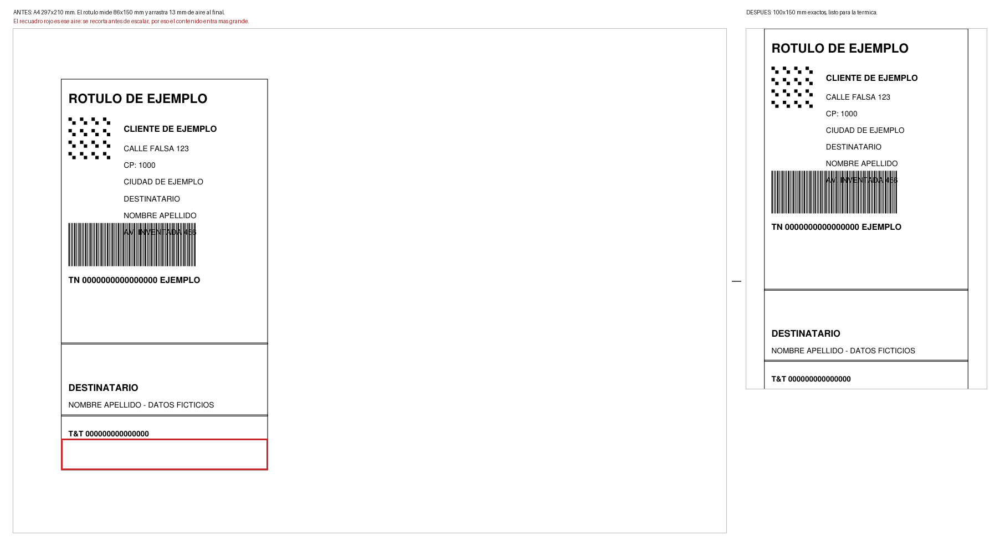
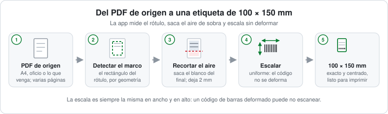

# Etiquetas 10x15

Un recurso de **Ardamir**

[](LICENSE)
[](https://github.com/arespaqui/etiquetas-10x15/actions/workflows/tests.yml)
[](#instalación)

Convierte un PDF de rótulo —A4, oficio, lo que venga— en un PDF de **100 × 150 mm exactos**,
listo para imprimir en una etiqueta térmica de 10 × 15 cm. Es para quien despacha envíos y no
quiere pelear con el tamaño del papel: si sabés elegir un PDF y hacer doble clic, lo podés usar.


## Índice

- [Qué hace](#qué-hace)
- [Manual completo](docs/manual.md) ← **empezá acá si es tu primera vez**
- [Instalación](#instalación)
  - [Opción 1: bajar el ejecutable (Windows)](#opción-1-bajar-el-ejecutable-windows)
  - [Opción 2: correr desde el código fuente](#opción-2-correr-desde-el-código-fuente)
- [Uso](#uso)
- [Cómo imprimir](#cómo-imprimir)
- [Cómo funciona](#cómo-funciona)
- [Solución de problemas](#solución-de-problemas)
- [Preguntas frecuentes](#preguntas-frecuentes)
- [Aviso legal](#aviso-legal)
- [Licencia](#licencia)
- [Contribuir](#contribuir)

## Qué hace

Toma un PDF de rótulo, **detecta el marco del rótulo**, **recorta el aire que sobra al final**
cuando lo hay y lo **escala sin deformar** hasta que entra en 100 × 150 mm.



En el ejemplo, el rótulo mide 86 × 150 mm y arrastra 13 mm de aire al final de la hoja (el
recuadro rojo). Ese aire se recorta antes de escalar, así el mismo contenido entra más grande en
la etiqueta: no se agranda nada, se aprovecha el espacio que estaba vacío.

En detalle:

- **Escribe siempre un archivo nuevo**: `<nombre>_10x15.pdf`, al lado del original. El PDF
  original **nunca** se modifica ni se borra.
- **Recorta el espacio muerto del final.** Si hay 5 mm o más de blanco al final del rótulo, ese
  aire se saca antes de escalar y la ventana avisa cuánto recortó.
- **Deja 2 mm de margen arriba y abajo del contenido**, para que la impresora térmica no se coma
  el borde de las letras al cortar el filo de la etiqueta.
- **Sabe qué es contenido y qué no.** El borde del marco del rótulo no cuenta como contenido:
  se excluye. Sí cuentan el texto, los dibujos internos y las imágenes, y la línea de corte es el
  fondo del contenido más 2 mm de margen, así que el recorte no puede dejar nada afuera.
- **Con menos de 5 mm de aire al final no recorta**: no vale la pena y deja el rótulo como está.
- **No estira nunca.** La escala es la misma en ancho y en alto. Si el rótulo de origen no tiene
  forma 10 × 15, lo deja centrado a escala uniforme y avisa cuánto blanco va a quedar.
- **Acepta varios PDFs a la vez** y PDFs de varias páginas: convierte todas las páginas.
- **No falla en silencio.** Cualquier error se muestra en la ventana y se anota en `errores.log`
  (mirá [Solución de problemas](#solución-de-problemas)).

### Qué NO hace, a propósito

- **No deforma los códigos.** Un código de barras estirado puede no escanear, y una etiqueta
  rechazada cuesta más que todo este proceso.
- **No inventa contenido.** Si el rótulo no entra, avisa; no lo agranda hasta cortarlo.
- **No imprime solo.** Vos elegís la impresora y confirmás la impresión.
- **No garantiza que el código escanee.** Deja los códigos sin deformar, que es lo que está de su
  lado; que un lector los tome depende también de la impresora, del contraste y de la calidad del
  rótulo de origen.

## Instalación

Hay dos caminos. Si sólo querés usar la herramienta, el camino corto es el ejecutable: **no hace
falta tener Python instalado**.

### Opción 1: bajar el ejecutable (Windows)

1. Descargá el `.zip` de la sección
   [**Releases**](https://github.com/arespaqui/etiquetas-10x15/releases/latest).
2. Descomprimí el zip **completo**, donde quieras (por ejemplo, el Escritorio). Adentro hay una
   carpeta `Etiquetas 10x15` con:

   | Contenido | Qué es |
   |---|---|
   | `Etiquetas 10x15.exe` | El programa. Se hace doble clic acá. |
   | `_internal\` | Python, PyMuPDF y todo lo que el `.exe` necesita para arrancar. |
   | `_internal\LEEME.md` | La guía de uso, dentro del propio paquete. |
   | `_internal\LICENSE`, `_internal\NOTICE` | La licencia AGPL-3.0 y el aviso de PyMuPDF/MuPDF. |

   **No separes el `.exe` de la carpeta `_internal\`**: el programa busca ahí sus bibliotecas y,
   si no las encuentra, no arranca.

3. Doble clic en **`Etiquetas 10x15.exe`**. Se abre la ventana, sin consola.

El ejecutable **no está firmado digitalmente**, porque firmar requiere un certificado de code
signing que este proyecto no tiene. Por eso Windows puede mostrar *"Windows protegió tu PC"* la
primera vez: se sigue con *Más información → Ejecutar de todas formas*. También es normal que
algún antivirus marque el arranque de PyInstaller como sospechoso: es un falso positivo conocido
por ser un binario nuevo y sin reputación. El código fuente está a la vista y cualquiera puede
compilar su propio `.exe` con el script de [`empaquetar/`](empaquetar/README.md).

### Opción 2: correr desde el código fuente

Necesitás **Windows** y **Python 3** en el `PATH` (probado con Python 3.12). Los lanzadores
`.bat` son de Windows; el motor de conversión es Python puro y se puede llamar desde la línea de
comandos en otros sistemas.

```
python -m pip install -r requirements.txt
```

Las dos dependencias están fijadas en [`requirements.txt`](requirements.txt):

| Paquete | Versión |
|---|---|
| `pymupdf` | `2.0` |
| `pillow` | `12.2.0` |

Después, doble clic en `1 - Abrir Etiquetas 10x15.bat` (o `python app_etiquetas.pyw`).

## Uso

¿Es la primera vez que lo usás, o no sabés si tu caso es para esta herramienta?
El **[manual completo](docs/manual.md)** lo explica de cero: cuándo usarla, cuándo
no, cómo leer cada aviso y qué hacer si algo falla.

1. Abrí la ventana: doble clic en **`1 - Abrir Etiquetas 10x15.bat`** (código fuente) o en
   **`Etiquetas 10x15.exe`** (versión descargada).
2. Tocá el botón verde **"Elegir PDF y convertir"**.
3. Elegí el PDF del rótulo. Podés elegir varios a la vez.
4. La ventana te cuenta qué hizo, página por página:

   ```
   OK  rotulo.pdf  ->  rotulo_10x15.pdf
      página 1: origen 86.0 x 163.0 mm  →  79.1 x 150.0 mm  (escala 92 %)
      ! El rótulo de origen no tiene forma 10×15: quedó con 10 mm de blanco a cada
        lado, a escala 92 % y sin deformar los códigos. Conviene pedir el rótulo en
        formato 10×15 al origen.
   ```

   - `origen` es lo que mide el rótulo dentro del PDF que elegiste.
   - `impreso` es lo que va a medir en tu etiqueta.
   - `escala` es cuánto se agrandó o achicó. Siempre es la misma en ancho y alto.
   - Un renglón con `!` en naranja es algo que tenés que saber **antes** de imprimir.
   - Cuando había aire de sobra al final, aparece además un renglón verde con cuánto se
     recortó, por ejemplo `recorté 13 mm de blanco del final: el rótulo entra más grande`.
     Si no había nada que recortar, ese renglón no aparece.
5. Tocá **"Abrir el PDF convertido"** y mandalo a imprimir con la configuración de
   [Cómo imprimir](#cómo-imprimir).

El archivo convertido queda al lado del original con el sufijo `_10x15`. Si ya existe, la app no
lo pisa: agrega `(2)`, `(3)`, etc.

### Sin ventana (alternativa)

- Arrastrá uno o más PDFs sobre **`2 - Arrastrar PDF (alternativa).bat`**.
- O desde la línea de comandos:

  ```
  python etiqueta_10x15.py rotulo.pdf
  ```

  Muestra los errores en la consola: sirve cuando la ventana no abre.

### Control de calidad de un PDF ya convertido

```
python verificar.py rotulo_10x15.pdf
```

Mide el tamaño de página, el tamaño de la tinta, si llena el alto, si está centrado y si se sale
de la página. Termina con `RESULTADO: TODO OK` o `HAY PROBLEMAS`.

## Cómo imprimir

Abrí el `<nombre>_10x15.pdf` generado y configurá la impresión así:

| Campo | Valor |
|---|---|
| Impresora | tu impresora de etiquetas térmica de 100 × 150 mm |
| Tamaño del papel | `Etiquetas 100x150` (o el tamaño 100 × 150 mm equivalente del driver) |
| **Escala** | **`Tamaño real`** — nunca "Ajustar al área de impresión" |
| Páginas por hoja | 1 |
| Rotación | ninguna (el PDF ya viene con la orientación que le corresponde) |

Si la etiqueta sale corrida, casi siempre es la escala: "Ajustar al área de impresión" reescala el
contenido y arruina la medida exacta.

## Cómo funciona



Tres ideas sostienen todo lo demás:

**1. El rótulo se detecta por su marco vectorial.** Los PDF de rótulo dibujan el rótulo como un
rectángulo contorneado. La app busca ese rectángulo y comprueba que adentro esté la mayor parte
del texto. No hay ninguna medida escrita a mano: si el proveedor cambia la plantilla, sigue
funcionando. ¿Por qué así y no midiendo la tinta? Porque los PDF que salen de los servicios de
merge arrastran basura fuera del rótulo —texto suelto, marcas de corte, motas—, y esa basura
infla cualquier medición ingenua. Si una página no tiene marco reconocible, la app cae al área
con tinta **y lo avisa**.

**2. El aire del final se recorta sin perder contenido.** La app calcula dónde empieza y
dónde termina el contenido real, y si el blanco del final llega a 5 mm lo descarta antes de
escalar, dejando **2 mm de margen** entre el contenido y el borde de la etiqueta. Para eso
distingue el marco de lo que hay adentro: **el borde del marco se excluye**, y sí cuentan el
texto, los dibujos internos y las imágenes. La línea de corte es el fondo del contenido más esos
2 mm, así que nada real puede quedar afuera. Si el aire al final no llega a 5 mm, no recorta: no
vale la pena.

**3. La escala es siempre uniforme.** El rótulo se agranda o se achica lo mismo en ancho y en
alto, y se centra en la página de 100 × 150 mm. Nunca se estira para llenar. Si la proporción de
origen se aparta más de un 3 % de 10:15, la app lo dice con números: cuánto mide el rótulo, cuánto
va a quedar impreso y cuánto blanco va a sobrar a los costados.

## Solución de problemas

**Sale una página en blanco o la etiqueta sale vacía.**
Casi siempre el PDF de origen no tiene el contenido donde la app lo busca. Abrí el PDF original y
mirá si el rótulo es realmente un marco con el texto adentro. Si en la ventana apareció un aviso
`!`, ese renglón explica qué pasó. Probá también `python verificar.py <archivo>_10x15.pdf` para
ver qué mide el resultado.

**Los códigos no leen en el escáner.**
La app no deforma nada, así que el problema suele estar antes o después de ella:

- Imprimí con escala **`Tamaño real`**, nunca "Ajustar al área de impresión".
- Revisá el contraste: si el rótulo de origen ya venía con el código claro o pixelado, la
  etiqueta térmica no lo va a mejorar.
- Mirá el aviso de proporción: si el rótulo de origen no era 10 × 15, quedó más chico de lo que
  podría. Pedir el rótulo en formato 10 × 15 al origen lo resuelve.
- Compará con el PDF de origen: si el código ya no leía ahí, el problema no es la conversión.

**La impresora imprime corrido o recortado.**
Es la escala de impresión o el tamaño de papel del driver. Papel `100x150`, escala `Tamaño real`,
1 página por hoja.

**Aparece "Recorté el aire que sobraba abajo…".**
Es información, no un aviso: la app sacó el blanco que sobraba al final para que el rótulo entre
más grande y dejó 2 mm de margen. No hay nada que revisar.

**Windows avisa "Windows protegió tu PC".**
El `.exe` no está firmado. *Más información → Ejecutar de todas formas*. El
[código fuente](https://github.com/arespaqui/etiquetas-10x15) está a la vista.

**Quiero el detalle del error.**
La app nunca falla en silencio: además del aviso en pantalla, escribe el detalle completo (con la
traza) en `errores.log`. La ubicación depende de cómo la abras:

| Cómo abrís la app | Dónde queda `errores.log` |
|---|---|
| `Etiquetas 10x15.exe` (versión empaquetada) | `Etiquetas 10x15\errores.log`, **junto al `.exe`** |
| Desde el código fuente | al lado del archivo `app_etiquetas.pyw` |
| Con la variable de entorno `ETIQUETAS_10X15_LOG` definida | en la ruta que indique esa variable |

El archivo sólo aparece cuando hubo un error. `ETIQUETAS_10X15_LOG` **gana siempre**, incluso con
el ejecutable: sirve para diagnosticar o para mandar el log a una carpeta donde sí se pueda
escribir.

## Preguntas frecuentes

**¿Necesito saber programar o tener Python?**
No. Con el ejecutable de Releases alcanza: se descomprime y se hace doble clic.

**¿Me modifica el PDF original?**
No. Siempre escribe un archivo nuevo `<nombre>_10x15.pdf`. El original queda intacto.

**¿Sirve para rótulos que no son de Correo Argentino?**
Sí. Sirve para cualquier PDF de rótulo que tenga su marco dibujado. Si el marco no aparece, usa el
área con tinta y avisa.

**¿Y si mi rótulo es más grande o más chico que la etiqueta?**
Se escala de forma uniforme hasta entrar, y se centra. Nunca se deforma.

**¿Funciona en Mac o Linux?**
El motor de conversión es Python puro y se puede llamar por línea de comandos. Los lanzadores
`.bat`, el `.exe` y la ventana están pensados para Windows.

**¿Por qué el archivo se llama `<nombre>_10x15.pdf`?**
Para que el original y el convertido no se confundan nunca.

**¿Puedo usarlo en mi empresa o en mi sistema?**
Sí, la licencia lo permite. Si distribuís una versión modificada, tenés que mantener el código
fuente disponible. Está todo en [Licencia](#licencia).

**¿Dónde reporto un problema o pido una mejora?**
En los [issues](https://github.com/arespaqui/etiquetas-10x15/issues) del repositorio. Antes de
adjuntar algo, leé [CONTRIBUTING.md](CONTRIBUTING.md): **no se adjuntan PDFs reales ni datos de
personas**.

## Aviso legal

Este es un proyecto **independiente**. **No es software oficial de Correo Argentino**, no está
afiliado ni respaldado por Correo Argentino y no reemplaza ningún sistema oficial. Es un conversor
de PDF a PDF que corre en tu propia computadora.

El programa se ofrece **sin garantía de ningún tipo**. En particular:

- **No garantiza que el código de barras escanee en todos los lectores.** La app hace su parte
  —no deformar el código—, pero el resultado depende también de la impresora, del contraste, de
  la calidad del PDF de origen y del lector.
- No garantiza que el rótulo impreso sea aceptado por el correo ni por ningún otro servicio.
- La responsabilidad por el uso del programa y por lo que se imprima con él es de quien lo usa.

## Licencia

Este proyecto se distribuye bajo **GNU Affero General Public License, versión 3 (AGPL-3.0)**. El
texto completo y canónico está en [`LICENSE`](LICENSE), y el aviso de componentes de terceros en
[`NOTICE`](NOTICE).

En criollo:

- Podés usar, estudiar, copiar, modificar y redistribuir este programa.
- **Si distribuís una versión modificada, tenés que mantener el código fuente disponible** para
  quien la reciba, bajo la misma licencia AGPL-3.0. Esto incluye ofrecerlo como servicio en red.
- No hay garantía de ningún tipo.

El paquete usa **PyMuPDF**, que incluye **MuPDF** de Artifex Software, distribuidos bajo AGPL-3.0.
El código fuente de esos componentes está en
[PyMuPDF](https://github.com/pymupdf/PyMuPDF) y [MuPDF](https://github.com/ArtifexSoftware/mupdf).
Artifex ofrece además una licencia comercial alternativa: <https://artifex.com/licensing/>.

## Contribuir

Las contribuciones son bienvenidas. Antes de mandar cambios, leé
[CONTRIBUTING.md](CONTRIBUTING.md): ahí están las reglas de las pruebas, la prohibición de subir
PDFs reales o datos de personas y la obligación AGPL de mantener el fuente disponible.

Para ver qué cambió en cada versión: [CHANGELOG.md](CHANGELOG.md).
