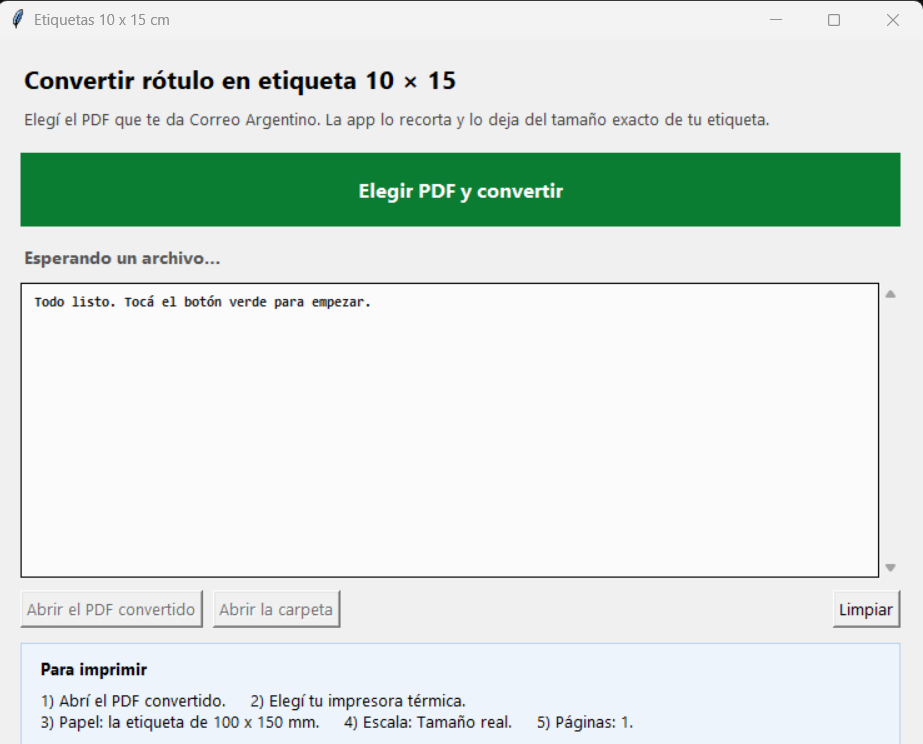

# Manual de Etiquetas 10 × 15

Este es el manual completo, en castellano y sin vueltas, para alguien que nunca
tocó un PDF más que para abrirlo. Si sólo querés el camino corto, mirá el
[LEEME](../LEEME.md); si querés el detalle técnico de cómo detecta el rótulo,
está en el [README](../README.md).



## Índice

- [Qué es y para quién](#qué-es-y-para-quién)
- [Cuándo usarlo](#cuándo-usarlo)
- [Cuándo NO usarlo](#cuándo-no-usarlo)
- [Requisitos](#requisitos)
- [Uso paso a paso](#uso-paso-a-paso)
- [Cómo leer lo que informa la ventana](#cómo-leer-lo-que-informa-la-ventana)
- [Qué hace con el espacio en blanco del final](#qué-hace-con-el-espacio-en-blanco-del-final)
- [Cómo imprimir](#cómo-imprimir)
- [Cómo comprobar el resultado](#cómo-comprobar-el-resultado)
- [Problemas frecuentes](#problemas-frecuentes)
- [Límites y aviso legal](#límites-y-aviso-legal)
- [Créditos y licencia](#créditos-y-licencia)

## Qué es y para quién

**Etiquetas 10 × 15** es un programa de escritorio para Windows que toma el PDF
de un rótulo de envío —el que te da el correo, el que te baja el sistema, el que
te manda un cliente— y lo devuelve como un PDF de **100 × 150 mm exactos**, que
es la medida de una etiqueta térmica de 10 × 15 cm.

El problema que resuelve es siempre el mismo: el PDF viene pensado para una hoja
A4, con el rótulo ocupando un pedazo de la hoja y mucho blanco alrededor. Si lo
mandás así a la impresora de etiquetas, la etiqueta sale con el rótulo chico,
desplazado o directamente cortado. Esta herramienta recorta el blanco que sobra,
escala el rótulo sin deformarlo y lo deja del tamaño de la etiqueta.

**Para quién es.** Para quien despacha envíos y no quiere pelear con el tamaño
del papel: alguien que atiende un local, un depósito chico, una agencia de
marketing que manda paquetes, o cualquiera que tenga una impresora térmica de
etiquetas y un PDF que no entra. **No hace falta saber nada de PDFs, de diseño ni
de programación**: si sabés elegir un archivo y hacer doble clic, lo podés usar.

**Qué hace, en una lista:**

- Escribe **siempre un archivo nuevo**, `<nombre>_10x15.pdf`, al lado del
  original. El PDF original nunca se modifica ni se borra.
- Detecta el marco del rótulo y **recorta el aire que sobra al final** cuando lo
  hay, dejando 2 mm de margen (ver [más abajo](#qué-hace-con-el-espacio-en-blanco-del-final)).
- **Escala sin deformar**: lo mismo en ancho y en alto. Nunca estira para llenar.
- Convierte **varios PDFs de una vez** y **todas las páginas** de cada PDF.
- **Avisa antes de imprimir** cuando el rótulo de origen no tiene forma 10 × 15 o
  cuando no pudo recortar con seguridad.
- **No falla en silencio**: si algo sale mal, lo dice en la ventana y lo anota en
  `errores.log`.

## Cuándo usarlo

La pregunta es una sola: **¿el PDF que tenés está ya en 100 × 150 mm exactos?**
Si la respuesta es no, esta herramienta es para vos. Si es sí, no hace falta.

| Situación concreta | ¿Lo usás? | Por qué |
|---|---|---|
| El PDF de Correo Argentino viene en **A4 con el rótulo chico** en el medio de la hoja | **Sí** | Es el caso típico. Detecta el marco del rótulo, descarta el blanco de la hoja y lo deja en 100 × 150 mm. |
| El **rótulo no entra en la etiqueta de 100 × 150** (sale chico o se sale por abajo) | **Sí** | El programa mide lo que hay que imprimir y lo escala de forma uniforme hasta que entre. |
| Hay que imprimir en una **térmica de etiquetas y el PDF no está en esa medida** | **Sí** | Es exactamente para lo que está hecho: convierte una medida cualquiera en 100 × 150 mm. |
| Tenés **varias etiquetas para convertir de una** | **Sí** | En la ventana podés elegir varios PDFs juntos; convierte todos y deja un `_10x15.pdf` por cada uno. |
| El PDF tiene **varias páginas**, una etiqueta por página | **Sí** | Convierte todas las páginas, cada una a su propia hoja de 100 × 150 mm. |
| El rótulo ya viene en **100 × 150 mm** exactos | **No hace falta** | No rompe nada, pero suma un paso y un archivo duplicado para nada. Ver la sección siguiente. |
| La etiqueta física es de **otro tamaño** (por ejemplo 80 × 50 mm) | **No** | Este programa entrega 100 × 150 mm y nada más. Para otro tamaño no es la herramienta. |
| Lo que querés es **recortar o tapar contenido** del rótulo | **No** | No edita el contenido: no borra el logo, no tapa datos, no cambia textos. |
| El problema es que **el código de barras no escanea** en tu lector | **No** | Eso se resuelve en la impresora, en el contraste y en el PDF de origen. Ver [Problemas frecuentes](#problemas-frecuentes). |

**La decisión en cuatro preguntas:**

1. ¿La etiqueta física que vas a usar mide **100 × 150 mm**? Si no, esta
   herramienta no es para ese trabajo.
2. ¿El PDF ya está en **100 × 150 mm**? Si sí, imprimilo y listo.
3. ¿El PDF es de una hoja grande con el rótulo adentro, o el rótulo no entra en la
   etiqueta? Entonces **sí**, usala.
4. ¿Lo que falla es la impresión o el escaneo? Entonces el problema no es el
   tamaño del PDF.

## Cuándo NO usarlo

Usar una herramienta cuando no hace falta también cuesta: un paso más, un archivo
más y una oportunidad de confundir el original con el convertido. Estos son los
casos en los que conviene no usarla, con el motivo de cada uno.

**1. El PDF ya es 100 × 150 mm exacto.**
No hace falta. Si lo convertís igual **no se rompe nada** —el resultado vuelve a
medir 100 × 150 mm, a escala 100 %— pero ganás un archivo `_10x15.pdf` idéntico al
que ya tenías y una chance de imprimir el equivocado. Si dudás, abrí el PDF y
mirá el tamaño de página en las propiedades: si dice 283 × 425 puntos (o
100 × 150 mm), ya está.

**2. La etiqueta física es de otro tamaño, por ejemplo 80 × 50 mm.**
Este programa tiene una única medida de salida: 100 × 150 mm. Si tu etiqueta es
más chica, el driver de la impresora va a reescalar o recortar el PDF que le
mandes, y ahí perdés el control de la medida exacta: el código puede quedar
cortado o deformado. Para otro tamaño de etiqueta, esto **no** es la herramienta.

**3. Hay que recortar contenido del rótulo.**
La herramienta recorta **espacio en blanco**, no contenido. No borra el logo del
cliente, no tapa la dirección, no saca un texto que sobra. Si el problema es que
el rótulo trae algo que no querés imprimir, eso se arregla en el sistema que
genera el rótulo o con un editor de PDF, no acá.

**4. El problema es que el código no escanea en el lector.**
Convertir el tamaño no arregla un código que ya venía mal. Si el código no lee,
las causas habituales son la escala de impresión (tiene que ser *Tamaño real*), el
contraste de la etiqueta térmica, la calidad del PDF de origen o el lector
mismo. Esta herramienta hace su parte —no deformar el código—, pero no puede
hacer las otras. Mirá la tabla de [Problemas frecuentes](#problemas-frecuentes).

**5. Lo que necesitás es un programa oficial del correo.**
No lo es, y no reemplaza a ninguno. Ver [Límites y aviso legal](#límites-y-aviso-legal).

## Requisitos

**Si usás el ejecutable (lo más simple):**

- **Windows** (10 u 11). No hace falta tener Python instalado.
- El `.zip` del programa, descomprimido **completo**: el `.exe` necesita la
  carpeta `_internal\` que viene al lado.
- Una **impresora térmica de etiquetas** que acepte etiquetas de 100 × 150 mm, y
  su driver instalado con ese tamaño de papel disponible.
- Etiquetas físicas de **100 × 150 mm**.
- El **PDF del rótulo** que querés convertir, sin contraseña.
- **No hace falta internet** ni ninguna cuenta: funciona en la computadora, con
  los archivos en el disco.

**Si corrés desde el código fuente:**

- Windows y **Python 3** en el `PATH` (probado con Python 3.12).
- Las dependencias de [`requirements.txt`](../requirements.txt):
  `python -m pip install -r requirements.txt`.
- Lo demás es igual: impresora, etiquetas y el PDF.

**Lo que no necesitás:** Photoshop, Acrobat de pago, una cuenta en la nube, ni
saber qué es un punto tipográfico.

## Uso paso a paso

1. **Abrí el programa.** Doble clic en `Etiquetas 10x15.exe` (versión descargada) o
   en `1 - Abrir Etiquetas 10x15.bat` (código fuente). Se abre la ventana, sin
   consola negra.

2. **Mirá la ventana.** Arriba dice *Convertir rótulo en etiqueta 10 × 15*. Abajo
   del título está el botón verde **"Elegir PDF y convertir"**, después el renglón
   de estado, el recuadro de texto donde aparece el detalle, los botones
   **"Abrir el PDF convertido"**, **"Abrir la carpeta"** y **"Limpiar"**, y al pie
   un recuadro celeste **"Para imprimir"** con los cinco pasos de la impresión.

3. **Tocá el botón verde.** Se abre el explorador de archivos.

4. **Elegí el PDF del rótulo.** Podés elegir **varios a la vez** (con `Ctrl` o
   `Shift`). Tocá *Abrir*.

5. **Esperá un segundo.** El botón cambia a *"Convirtiendo…"* y vuelve solo. El
   recuadro de texto se llena con el resultado.

6. **Leé el detalle.** Por cada archivo aparece un renglón `OK` y, debajo, el
   resumen de cada página: origen, impreso y escala. Si hay un renglón que empieza
   con `!`, está en naranja y **tenés que leerlo antes de imprimir**. Cómo
   interpretarlo está en la sección siguiente.

7. **Abrí el resultado.** Tocá **"Abrir el PDF convertido"** y se abre el archivo
   nuevo en tu lector de PDF. Con **"Abrir la carpeta"** llegás a la carpeta donde
   quedaron el original y el convertido.

8. **Imprimí** con la configuración de [Cómo imprimir](#cómo-imprimir).

9. **Para convertir otro lote**, tocá **"Limpiar"** y volvé al paso 3. El recuadro
   se vacía y la ventana queda lista.

**Dónde queda el archivo convertido.** Siempre **al lado del original**, con el
sufijo `_10x15` antes de la extensión: si elegiste `rotulo.pdf`, el resultado es
`rotulo_10x15.pdf`. Si ese nombre ya existía, no lo pisa: agrega `(2)`, `(3)`,
etc. **El PDF original nunca se toca.**

**Sin ventana, si la ventana no abre:**

- Arrastrá uno o más PDFs sobre `2 - Arrastrar PDF (alternativa).bat`. Los
  mensajes se ven en una consola.
- O desde la línea de comandos, dentro de la carpeta del programa:
  `python etiqueta_10x15.py rotulo.pdf`.

## Cómo leer lo que informa la ventana

La ventana no adorna: cada renglón dice algo que necesitás para decidir si
imprimís. Este es un resultado real, con los tres tipos de renglón:

```
OK  rotulo.pdf  ->  rotulo_10x15.pdf
   página 1: origen 86.0 x 163.0 mm  →  79.1 x 150.0 mm  (escala 92 %)
   recorté 13 mm de blanco del final: el rótulo entra más grande
   ! El rótulo de origen no tiene forma 10×15: quedó con 10 mm de blanco a cada
     lado, a escala 92 % y sin deformar los códigos. Conviene pedir el rótulo en
     formato 10×15 al origen.
```

**El renglón `OK nombre.pdf -> nombre_10x15.pdf`.** Dice que ese archivo se
convirtió y con qué nombre quedó el resultado. Si en lugar de `OK` ves una `X`,
ese archivo **no** se convirtió: abajo está el motivo, y el detalle completo queda
en `errores.log`.

**`origen`** es lo que mide el rótulo **dentro del PDF que elegiste**, ya sin el
blanco de la hoja. En el ejemplo, el rótulo ocupa 86 × 163 mm en el PDF original.

**`impreso`** es lo que va a medir **en tu etiqueta** después de la conversión. En
el ejemplo, 79,1 × 150 mm: entra en el alto de la etiqueta y deja 10 mm libres a
cada lado porque la proporción del original no era 10 × 15.

**`escala`** es cuánto se agrandó o se achicó, en porcentaje. `92 %` quiere decir
que el rótulo se achicó un 8 %. **La escala es siempre la misma en ancho y en
alto**: por eso los códigos de barras no se deforman. Si ves `100 %`, el rótulo ya
estaba en la medida justa.

**El renglón verde `recorté N mm de blanco del final`.** Aparece **sólo** cuando
había aire de sobra al final del rótulo y se pudo sacar, y dice cuántos milímetros
se ganaron. Gracias a eso el mismo contenido entra más grande. Si no había nada
que recortar, el renglón no aparece: no es un error, es que no hacía falta.

**El renglón naranja que empieza con `!`.** Es un aviso: algo que tenés que saber
**antes** de imprimir. Los tres avisos posibles son:

| Aviso (empieza con `!`) | Qué significa |
|---|---|
| *El rótulo de origen no tiene forma 10×15: quedó con N mm de blanco a cada lado…* | El rótulo original tiene otra proporción. El resultado entra igual y los códigos no se deforman, pero queda blanco a los costados y la escala no es la máxima posible. Se arregla pidiendo el rótulo en formato 10 × 15 a quien te lo genera. |
| *No encontré el marco del rótulo en esta página: usé el área con tinta…* | El PDF no tiene el marco dibujado (o no se pudo validar). El programa usó todo lo que tiene tinta, que puede incluir marcas sueltas de la hoja. **Revisá el resultado antes de imprimir.** |
| *No se recorta el espacio muerto porque hay contenido (…) fuera del área calculada…* | El recorte encontró una imagen o un dibujo ancho que no puede ver del todo y, antes que borrarlo, dejó el espacio como estaba. **Revisá el resultado antes de imprimir.** |

**El renglón de estado**, abajo del botón verde, resume el lote en una frase:

| Estado | Qué quiere decir |
|---|---|
| *Listo: N rótulo(s) convertido(s) al tamaño exacto.* (verde) | Todo salió bien. A imprimir. |
| *Convertido. Ojo: el rótulo no es 10×15 (mirá el aviso naranja).* (naranja) | Se convirtió, pero hay un aviso. Leelo antes de imprimir. |
| *Convertidos N, con M error(es).* (naranja) | Algunos archivos se convirtieron y otros no. El detalle está abajo. |
| *No se pudo convertir ningún archivo.* (rojo) | Ninguno salió. El motivo está abajo y en `errores.log`. |

## Qué hace con el espacio en blanco del final

Los PDF de rótulo casi siempre arrastran blanco de más: el rótulo está dibujado
arriba de la hoja y abajo sobra un dedo de aire. Si ese aire no se saca, cuando el
programa escala el rótulo para que entre en la etiqueta, **también escala el
aire**, y el contenido termina más chico de lo que podría ser.

Por eso, antes de escalar, el programa hace tres cosas:

1. **Mide** dónde empieza y dónde termina el contenido real del rótulo.
2. **Recorta el aire del final sólo si llega a 5 mm.** Menos que eso no vale la
   pena y no se toca. Cuando recorta, lo dice: `recorté 13 mm de blanco del final`.
3. **Deja 2 mm de margen entre el contenido y el borde de la etiqueta.** La
   impresora térmica corta el filo de la etiqueta y se come los primeros
   milímetros: sin ese margen, la primera línea de texto o el borde de un código
   puede salir cortado. Los 2 mm son la razón por la que el contenido no toca el
   borde aunque parezca que sobra lugar.

**El recorte es conservador a propósito.** El programa sólo ve texto y dibujos; si
encuentra una **imagen** o un **dibujo ancho** que quedaría afuera del área
calculada, **no recorta nada** y muestra el aviso naranja. Prefiere una etiqueta
un poco más chica antes que una etiqueta con un logo borrado. Si ves ese aviso,
abrí el PDF convertido, revisá que esté todo y recién ahí imprimí.

**El recorte es sólo del final.** No recorta a los costados ni arriba. Si el
rótulo original es ancho y la etiqueta queda con blanco a los costados, eso es la
proporción del original, no un error: el programa lo informa en `impreso` y en el
aviso de proporción.

## Cómo imprimir

Abrí el `<nombre>_10x15.pdf` generado y configurá la impresión así:

| Campo | Valor |
|---|---|
| Impresora | tu impresora de etiquetas térmica de 100 × 150 mm |
| Tamaño del papel | `Etiquetas 100x150` (o el tamaño 100 × 150 mm equivalente del driver) |
| **Escala** | **`Tamaño real`** — *nunca* "Ajustar al área de impresión" |
| Páginas por hoja | 1 |
| Rotación | ninguna (el PDF ya viene con la orientación que le corresponde) |
| Márgenes | los del PDF (no agregar márgenes extra ni "centrar en la página" si el driver lo permite) |

Dos advertencias que evitan casi todos los problemas:

- **"Ajustar al área de impresión" arruina la medida exacta.** El PDF ya mide
  100 × 150 mm; si la impresora lo reescala, el contenido queda más chico o más
  grande y los códigos se deforman. Tiene que ser **Tamaño real**.
- **El tamaño de papel lo manda el driver.** Si en la lista no aparece
  100 × 150 mm, mirá en las propiedades de la impresora: hay que tener cargado el
  tamaño de la etiqueta que estás usando.

**Antes de imprimir en cantidad, imprimí una.** Pasá el lector por esa primera
etiqueta y confirmá que el código lee. Recién después seguí con el resto.

## Cómo comprobar el resultado

Si querés una segunda opinión sobre el PDF convertido —o si algo salió raro y
querés números en vez de impresiones— usá `verificar.py`, que viene en el paquete.
Mide el archivo y no lo modifica:

```
python verificar.py rotulo_10x15.pdf
```

Este comando es de la **versión código fuente**: necesita Python y las
dependencias de [`requirements.txt`](../requirements.txt) instaladas. El
ejecutable no incluye este control aparte; si usás el `.exe`, el equivalente es
mirar el detalle de la ventana y abrir el PDF convertido antes de imprimir.

Informa, página por página:

| Renglón | Qué mira | Cuándo está bien |
|---|---|---|
| `tamano de pagina` | el tamaño de la hoja del PDF | `100.00 x 150.00 mm` |
| `tinta` | el rectángulo que ocupa todo lo impreso | cercano a 100 × 150 mm (el comando dice en qué punto empieza) |
| `proporcion` | ancho ÷ alto de la tinta contra 100 ÷ 150 | desvío chico (se muestra en %) |
| `llena el alto` | si la tinta llega al alto de la etiqueta | `si` |
| `centrado en X` | si el contenido está centrado a lo ancho | `si` |

Termina con **`RESULTADO: TODO OK`** o **`RESULTADO: HAY PROBLEMAS`**, y el
código de salida es `0` en el primer caso y `1` en el segundo (sirve para
automatizar). Los casos que marcan problema son: tamaño de página distinto de
100 × 150 mm, página vacía, contenido que no llena el alto, contenido descentrado
o contenido que se sale de la página.

Un resultado `HAY PROBLEMAS` no siempre significa que la etiqueta sea inservible:
por ejemplo, un rótulo de origen angosto deja blanco a los costados y el
verificador lo informa como proporción fuera de rango. Si el aviso de la ventana
ya te dijo lo mismo y el contenido está entero, es esperable. Lo que **nunca**
conviene imprimir es un contenido que se sale de la página.

## Problemas frecuentes

| Síntoma | Causa probable | Qué hacer |
|---|---|---|
| La etiqueta sale **en blanco** o casi vacía | El PDF de origen no tiene el contenido donde el programa lo busca, o es una página realmente vacía | Abrí el PDF original y mirá si el rótulo es un marco con el texto adentro. Si en la ventana hubo un `!`, ese renglón lo explica. Probá `python verificar.py` sobre el convertido |
| La etiqueta sale **corrida, chica o recortada** | La escala de impresión no es *Tamaño real*, o el driver no tiene el papel de 100 × 150 mm | Papel `100x150`, escala **`Tamaño real`**, 1 página por hoja, sin rotación |
| **El código no escanea** en el lector | Escala de impresión, contraste, calidad del origen o el propio lector | Imprimí en *Tamaño real*; compará con el PDF original (si ahí ya no leía, el problema no es la conversión); revisá el contraste; mirá el aviso de proporción; probá con otro lector |
| El resultado tiene **mucho blanco a los costados** | El rótulo de origen no tiene proporción 10 × 15 y el programa no estira | Es a propósito: estirar deforma los códigos. Pedí el rótulo en formato 10 × 15 a quien te lo genera |
| Aparece **"no se recorta el espacio muerto…"** | Hay una imagen o un dibujo ancho fuera del área calculada y recortar lo borraría | Es la guarda conservadora. Abrí el PDF convertido, revisá que esté todo y después imprimí |
| Aparece **"No encontré el marco del rótulo…"** | El PDF no tiene el marco vectorial del rótulo | Se usó el área con tinta, que puede incluir marcas sueltas. Revisá el resultado antes de imprimir |
| **El PDF original cambió o desapareció** | No debería pasar: el programa siempre escribe un archivo nuevo | Buscá el `<nombre>_10x15.pdf` al lado del original. Si el nombre ya existía, el nuevo es `(2)`. El original no se toca nunca |
| **Windows avisa "Windows protegió tu PC"** | El `.exe` no está firmado digitalmente | *Más información → Ejecutar de todas formas*. Es un binario nuevo, sin reputación; el código fuente está a la vista |
| **La ventana no abre** | Falla de tkinter o del entorno de Python | Arrastrá el PDF sobre `2 - Arrastrar PDF (alternativa).bat`: los errores se ven en la consola |
| **"falta PyMuPDF"** | Corrés desde el código fuente sin las dependencias | `python -m pip install -r requirements.txt` |
| **El error no se entiende** | — | El detalle completo está en `errores.log`: junto al `.exe` si es la versión empaquetada, al lado de `app_etiquetas.pyw` si es código fuente, o donde indique la variable `ETIQUETAS_10X15_LOG` |
| **El `.exe` no arranca** | Se separó el `.exe` de la carpeta `_internal\` | Descomprimí el zip completo y no muevas el `.exe` fuera de su carpeta |

## Límites y aviso legal

**Qué es y qué no es.** Este es un proyecto **independiente**. **No es software
oficial de Correo Argentino**, no está afiliado ni respaldado por Correo Argentino
y no reemplaza ningún sistema oficial. Es un conversor de PDF a PDF que corre en
tu propia computadora, sin conexión y sin cuentas.

**Qué garantiza y qué no.** El programa se ofrece **sin garantía de ningún tipo**.
En particular:

- **No garantiza que el código de barras escanee en todos los lectores.** Hace su
  parte —no deformar el código, no cortarlo, dejar margen en el borde—, pero el
  resultado depende también de la impresora, del contraste de la etiqueta, de la
  calidad del PDF de origen y del lector. **Probá una etiqueta antes de imprimir
  en cantidad.**
- No garantiza que el rótulo impreso sea aceptado por el correo ni por ningún otro
  servicio. La aceptación la decide quien recibe el envío, no este programa.
- No corrige un PDF de origen ilegible, con el código pixelado o con datos
  equivocados.

**Qué no hace, por diseño.** No deforma los códigos, no inventa contenido, no
borra ni tapa nada, no imprime solo (vos elegís la impresora y confirmás) y no
sirve para etiquetas de otro tamaño que no sea 100 × 150 mm.

**La responsabilidad** por el uso del programa y por lo que se imprima con él es
de quien lo usa.

## Créditos y licencia

**El recurso.** Este paquete es un recurso de **Ardamir**. La marca Ardamir y su
logo pertenecen a su titular; si querés usarlos, mirá
[la guía de marca](marca/paleta.md) antes.

**El software.** Se distribuye bajo **GNU Affero General Public License, versión 3
(AGPL-3.0)**. El texto completo y canónico está en [`LICENSE`](../LICENSE) y el
aviso de componentes de terceros en [`NOTICE`](../NOTICE). En criollo:

- Podés usar, estudiar, copiar, modificar y redistribuir el programa.
- **Si distribuís una versión modificada, tenés que mantener el código fuente
  disponible** para quien la reciba, bajo la misma licencia AGPL-3.0. Esto incluye
  ofrecerlo como servicio en red.
- No hay garantía de ningún tipo.

**Componentes de terceros.** El paquete usa **PyMuPDF**, que incluye **MuPDF** de
Artifex Software, ambos bajo AGPL-3.0. El código fuente de esos componentes está
en [PyMuPDF](https://github.com/pymupdf/PyMuPDF) y
[MuPDF](https://github.com/ArtifexSoftware/mupdf); Artifex ofrece además una
licencia comercial alternativa en <https://artifex.com/licensing/>. El detalle
está en [`NOTICE`](../NOTICE).

**Cómo seguir.** Cómo funciona por dentro y preguntas frecuentes:
[README](../README.md). Guía corta para el día a día: [LEEME](../LEEME.md).
Reglas para mandar cambios: [CONTRIBUTING](../CONTRIBUTING.md). Qué cambió en cada
versión: [CHANGELOG](../CHANGELOG.md).

---

Manual de Etiquetas 10 × 15 — un recurso de **Ardamir**. Software bajo AGPL-3.0.
