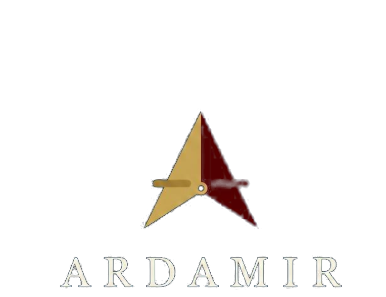

# Paleta y uso de marca — Ardamir

Guía corta para usar la identidad de **Ardamir** sin romperla. Todo lo que está
acá sale de medir el logo entregado: los valores son los medidos, no una
aproximación de memoria.

## Colores

| Nombre | Hex | Para qué sirve |
|---|---|---|
| **Navy** | `#0F1D2A` | El color base de la marca. Fondo principal de piezas oscuras, y color de texto sobre fondos claros (crema o blanco). Es el que da el tono sobrio. |
| **Dorado** | `#C9A24C` | Acento principal: filetes, detalles del logo, subtítulos destacados, palabras que hay que mirar. Sobre navy tiene buen contraste; sobre crema, úsalo como acento, no como texto corrido. |
| **Dorado brillo** | `#D6A547` | La misma familia, un punto más luminosa. Para estados *hover*, subrayados, separadores finos y detalles sobre fondo oscuro. |
| **Vino** | `#5A0001` | Acento secundario y de peso: sellos, etiquetas de énfasis, bloques que tienen que llamar la atención. Es un color oscuro: no lo uses como texto sobre navy. |
| **Vino brillo** | `#680001` | Variante de énfasis del vino, para detalles y bordes. Mismas precauciones que el vino. |
| **Crema** | `#F5EFDF` | Fondo claro de la marca y color de texto sobre navy. Es el reemplazo cálido del blanco puro; úsalo también para áreas grandes de lectura. |

**Combinaciones que funcionan:** navy sobre crema, crema sobre navy, dorado sobre
navy, navy sobre dorado claro, crema sobre vino.
**Combinaciones que no:** vino sobre navy (contraste bajísimo), dorado sobre crema
para texto chico, y cualquier texto de color sobre una foto sin velo.

## Los tres archivos del logo

Los tres viven en esta misma carpeta (`docs/marca/`).

| Archivo | Medidas | Fondo | Cuándo usarlo |
|---|---|---|---|
| `logo-ardamir.png` | 764 × 588 px | Navy sólido (el fondo original de la pieza) | Cuando el fondo de la pieza ya es navy o cuando no querés recortar nada: es el logo tal como se entregó. Ideal para documentos y piezas donde el bloque navy funciona como sello. |
| `logo-transparente.png` | 764 × 588 px | Transparente (canal alfa) | El de uso general: web, README, presentaciones, tarjetas, sellos de pie de página. Se apoya sobre crema o blanco sin caja visible. **Ojo:** la palabra *ARDAMIR* está en navy con un halo claro, así que sobre fondos oscuros pierde cuerpo; para fondo navy conviene el archivo anterior. |
| `tarjeta-redes.png` | 1200 × 630 px | Navy con la marca | La imagen de vista previa al compartir un enlace o un post (Open Graph / Twitter Card). Es la medida estándar de previsualización de redes: no la uses como logo ni la recortes a otra proporción. |

## Tamaño mínimo

- **En pantalla: no menos de 96 px de ancho** para el logo completo con la
  palabra. Por debajo de eso el halo de las letras se empasta y no se lee.
- **Impreso: no menos de 20 mm de ancho.** Con menos, el detalle fino del centro
  del símbolo se cierra al imprimir.
- Si necesitás algo más chico que eso, no achiques más el logo: en ese caso la
  marca va sólo con el nombre escrito como texto.

## Cosas que no se hacen

- **No deformar el logo.** Nada de estirarlo o aplastarlo para que entre: si no
  entra, se achica proporcionalmente.
- **No cambiarle los colores.** El navy, el dorado y el vino son parte de la
  marca. Tampoco lo pases a blanco y negro, ni le agregues degradados, sombras o
  contornos.
- **No ponerlo sobre fondos que le bajen el contraste.** Nada de logo navy sobre
  gris medio, sobre foto sin velo ni sobre un color parecido al suyo.
- **No recortarlo ni taparlo.** No cortes el halo de las letras ni pongas texto
  encima del símbolo.
- **No separar la palabra del símbolo** ni reordenar sus partes.
- **No rotarlo** ni inclinarlo.

## Licencia y marca: dos cosas distintas

La licencia **AGPL-3.0** cubre **el software**: el código, el ejecutable, la
documentación de este repositorio. Es lo que permite usarlo, estudiarlo,
modificarlo y redistribuirlo conservando el código fuente disponible.

**La marca Ardamir no va incluida en esa licencia.** El nombre *Ardamir* y su logo
pertenecen a su titular. Que el programa sea libre no autoriza a presentar una
versión modificada como si fuera de Ardamir ni a usar la marca para respaldar un
producto ajeno. El código podés reusarlo bajo AGPL-3.0; la marca, no.

Para el detalle legal del software: [`LICENSE`](../../LICENSE) y
[`NOTICE`](../../NOTICE).
